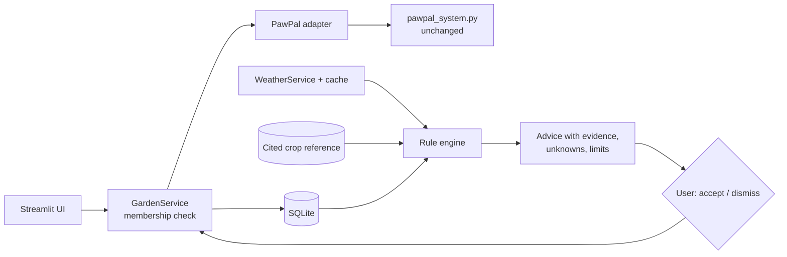

# 🌿 Verdant — family garden planner

*Grow with knowledge. Care with confidence.*

Verdant is a location-aware garden planner for one operator who manages several gardens (for example, their own garden and their mother's). It keeps a real seed inventory, growing spaces, plantings, recurring care tasks, a field journal, cached weather forecasts, and **explainable, evidence-backed planting advice** that never changes your schedule without your approval.

## Base project: PawPal+ (AI110 Module 2)

Verdant extends **PawPal+**, my Module 2 pet-care planner. PawPal+ modelled an owner, pets and dated tasks with high/medium/low priority, once/daily/weekly recurrence, completion history, conflict (overlap) warnings and a greedy plan that fits tasks into available minutes and hours, with a Streamlit UI and 29 tests. Its original README is kept at [docs/pawpal_original_README.md](docs/pawpal_original_README.md). `pawpal_system.py`, `app.py`, `main.py` and the original tests are **unchanged**; Verdant reuses the scheduler through an adapter.

## What the AI part does

Verdant's AI feature is a **retrieval-grounded advisory agent with a reliability harness**:

1. **Retrieve** evidence for one garden: the cached forecast (Open-Meteo), the growing space (indoor/outdoor/covered, light source), each planting's stage, and a cited crop reference table.
2. **Reason** with deterministic rules: frost risk for frost-tender crops in exposed spaces; rain → *check soil before watering* (outdoor only); grow light with unknown intensity → *insufficient data*; missing or stale weather → *advice paused*.
3. **Explain**: every advisory stores its evidence (value, unit, source, fetch time, origin), unknowns, limitations and expiry.
4. **Human in the loop**: the user accepts (creates exactly one task) or dismisses (not raised again). Nothing is created, moved or completed automatically.
5. **Verify**: 51 new automated tests plus a 12-scenario evaluation script with guardrail checks.

Rules come before generative AI on purpose: garden advice must not invent agronomic facts. When data is missing, Verdant says `insufficient_data` instead of guessing.

## Architecture

Source: [diagrams/architecture.mmd](diagrams/architecture.mmd). Migration plan: [docs/verdant_migration_plan.md](docs/verdant_migration_plan.md).



| Layer | Files | Responsibility |
| --- | --- | --- |
| Domain | `verdant/domain/` | Validated dataclasses: Garden, GrowingSpace, SeedVariety, SeedInventoryItem, Planting, GardenTask, Observation, WeatherSnapshot, Recommendation |
| Scheduling | `verdant/scheduling/pawpal_adapter.py` | One garden → one PawPal `Owner`; GardenTask ↔ PawPal `Task` with the same ID. Validation, recurrence, overlaps and plans come from the original code |
| Persistence | `verdant/persistence/` | `Repository` interface, SQLite implementation, SQL migration `001_initial.sql` |
| Services | `verdant/services/` | `GardenService` (all reads/writes, access checks, garden scope), seed import, weather, rule engine, photo validation |
| UI | `verdant_app.py`, `verdant/ui/` | Dashboard, Seed Library, My Plants, Garden Spaces, Calendar, Field Journal, Settings; persistent garden switcher |

## Setup

Python 3.10+. From the project folder:

```powershell
python -m venv .venv
.\.venv\Scripts\Activate.ps1
python -m pip install --upgrade pip
pip install -r requirements.txt
python -m pytest -q
python verdant_demo.py
python scripts/evaluate_recommendations.py
python -m streamlit run verdant_app.py
```

macOS/Linux: `source .venv/bin/activate`. No API key is needed: Open-Meteo is free for non-commercial use. To run with no network at all, set `VERDANT_WEATHER=offline` (weather then shows as unavailable; nothing is invented). Other settings are in [.env.example](.env.example). Data is stored in `data/verdant.db` (git-ignored). The original PawPal+ app still runs with `python -m streamlit run app.py`.

**Quick look:** click **Load sample gardens**, then Dashboard → *Check weather & advice*. **First run with your own data:** create your gardens → Settings → search your city → *Use this location* → (optionally) import the packet list into your own garden → add growing spaces → start plantings from the Seed Library → Dashboard → *Check weather & advice*.

## Deploy (Streamlit Community Cloud)

1. Sign in at [share.streamlit.io](https://share.streamlit.io) with GitHub → **Create app** → *Deploy a public app from GitHub*.
Live app: https://verdant-garden-planner.streamlit.app

2. Repository `rinnyssance/verdant-garden-planner`, branch `main`, main file `verdant_app.py`. Under *Advanced settings* choose Python 3.10 or newer.
3. After it starts, open the app's **Settings → Sharing** and make it **private (invite only)** if you will store real garden data.

Caveats for this MVP: there is no sign-in yet, so anyone who can open a public URL can view and edit every garden, including its city. The SQLite file lives on the container's disk and is **reset whenever the app restarts or redeploys**. Durable, per-user storage arrives with Supabase in Phase 3. Vercel is not suitable: it runs short-lived serverless functions, while Streamlit needs a long-running server with websockets.

## Sample interactions

All three are reproducible from the commands above. Full output: [docs/demo_output.txt](docs/demo_output.txt), [docs/evaluation_results.txt](docs/evaluation_results.txt).

**1. Two gardens stay separate; owning seeds ≠ growing them** (`python verdant_demo.py`)

```text
1) Import the packet list into My Garden only
   {'added': 26, 'skipped': 0}
   My Garden seeds: 26 (8 need review, e.g. Parsley 'Italian / plain')
   Mom's Garden seeds: 0   plantings anywhere: 0
```

**2. Advice with evidence and approval** (scripted forecast: lows 45, 31, 40 °F; 80 % rain today)

```text
4) Weather + advisory rules (scripted forecast: lows 45, 31, 40 F; 80% rain today)
   [action] needs_adjustment  Check cold protection for Sweet basil
   [info  ] needs_adjustment  Check soil moisture in Sunny raised bed before watering
   [info  ] insufficient_data Add grow-light details for Seed shelf
...
5) Nothing changes until the user decides
   Tasks before accept: 3; after accepting twice: 4 (new: 'Check cold protection for Sweet basil', source=suggested)
   Mom's Garden tasks: 0; advice: 0
```

Kale in the same bed gets no frost alert (frost-tolerant), and the indoor shelf gets no rain advice. The frost advisory as JSON:

```json
{
  "suitability": "needs_adjustment", "severity": "action",
  "title": "Check cold protection for Sweet basil",
  "explanation": "The forecast low for Tue Nov 17 is 31°F. Sweet basil is listed as frost-tender and is in 'Sunny raised bed' (outdoor), which is exposed to outdoor temperatures.",
  "evidence": [{"type": "forecast_low", "value": 31, "unit": "F", "for_date": "2026-11-17",
                "source": "Scripted test forecast", "fetched_at": "2026-11-16T12:00:00+00:00", "origin": "forecast"}],
  "unknowns": ["actual plant-level temperature", "microclimate around the plant"],
  "suggested_task": {"description": "Check cold protection for Sweet basil", "priority": "high"},
  "requires_user_approval": true
}
```

**3. Guardrails under bad or missing data** (`python scripts/evaluate_recommendations.py`)

```text
 7. PASS  Unknown sensitivity (rosemary), low 30F        -> frost_risk/info/insufficient_data
10. PASS  Rain 80% in a greenhouse                       -> no advice
11. PASS  Grow light without PPFD                        -> grow_light/info/insufficient_data
12. PASS  Weather outage with outdoor basil              -> data_quality/watch/insufficient_data

Summary: 12/12 scenarios matched expected advice; 12/12 passed all guardrails (deterministic, no automatic task changes, evidence present, unknowns stated).
```

In the running app with the live Open-Meteo forecast for a Richmond, VA test location on 2026-11-16 (low 35 °F), the Dashboard showed one *Watch* advisory for outdoor basil, none for kale or the indoor microgreens, and a grow-light *insufficient data* item.

## Design decisions and trade-offs

- **Adapter over rewrite.** Garden tasks run through the unmodified PawPal scheduler, so 29 existing tests still guard the core rules. Cost: plantings/spaces are mapped onto PawPal's `Pet` grouping, which is slightly awkward internally.
- **Garden = PawPal owner.** Overlap warnings and plans are computed per garden, never across gardens.
- **Authorization in the service layer now, RLS later.** Every call checks membership (owner/editor/viewer); unknown and forbidden gardens return the same error. Supabase Auth + row-level security is planned (Phase 3); today there is one local operator and no sign-in.
- **SQLite first.** Durable, zero-setup, testable. The `Repository` interface allows a Supabase implementation later.
- **Rules, not an LLM, decide.** Deterministic rules are testable and traceable. An optional LLM could later rephrase explanations but must not add facts.
- **Conservative thresholds, stated as such.** Frost watch ≤ 36 °F, action ≤ 32 °F for tender crops; rain ≥ 60 % or ≥ 0.25 in. These are advisory defaults, not validated limits, and each advisory says so.
- **Stale data is shown, not used.** If a refresh fails, the old forecast is displayed with its timestamp but advisories pause.
- **`st.segmented_control` instead of `st.tabs`** so the app stays on the same screen after each save (found while testing the running app).

## Testing summary

```text
python -m pytest -q
81 passed
```

29 original PawPal+ tests (unchanged) + 52 new tests: domain validation, garden scope in the adapter, recurrence history, SQLite reload/rollback/isolation, permissions (non-members, viewers, invited editor), seed import (one garden, flags, idempotent, nothing invented), weather (cache, expiry, outage, stale, per-garden), rules (each advisory, negatives, boundaries, determinism, accept-once, dismiss-remembered, cross-garden accept blocked), photo validation, and Streamlit AppTest flows. The evaluation script adds 12 scenario checks (12/12).

What worked: reusing PawPal rules kept recurrence and conflicts correct with no new scheduling code. What didn't at first: clicking through the real app exposed three bugs the unit tests missed (tabs resetting after each action, a cached repository rejecting hot-reloaded classes, and a CSS rule that broke icon fonts). Lesson: UI tests that render everything at once can hide navigation problems.

Not yet verified: real sign-in/RLS (not built), USDA zone lookup, behaviour across time-zone/DST changes, and screen-reader use.

## Data sources and attribution

- Weather data by [Open-Meteo.com](https://open-meteo.com/) (CC BY 4.0). Verify current terms before commercial use.
- Crop frost-sensitivity classes follow the warm-/cool-season split published by extension services; citation: Virginia Cooperative Extension, *Vegetable Planting Guide and Recommended Planting Dates* (426-331). The table is marked `needs_review` until checked against that publication.
- Seed list transcribed from the operator's packet photos; uncertain names are flagged.

## Roadmap

Phase 2 remainder: *Can I plant now?* with cited frost-window data. Phase 3: Supabase Auth/Postgres/RLS, invitation for Mom, private photo storage. Phase 4: journal charts, NASA POWER history, verified plant-reference enrichment.

## Reflection

Responsible-AI reflection, limitations and AI-collaboration notes are in [model_card.md](model_card.md).
