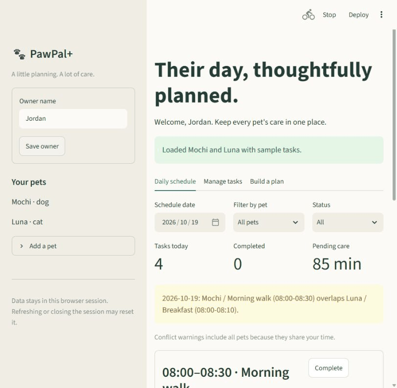
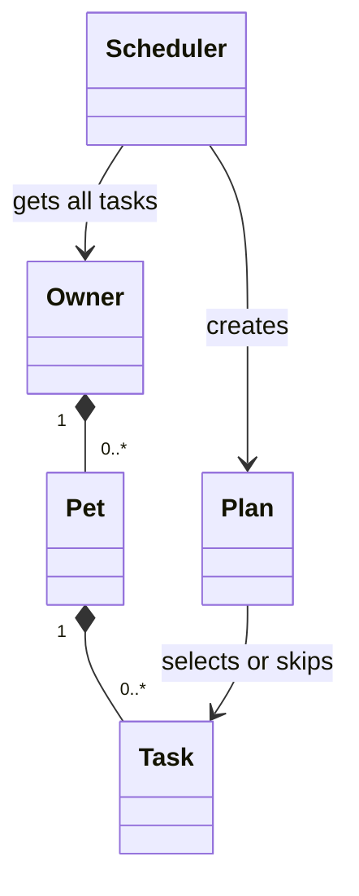

# PawPal+

A pet care planner built with Python dataclasses and Streamlit for CodePath AI110 Project 2. Manage multiple pets, schedule routines, complete tasks, and create a daily plan that fits your available time.

## App preview



The animated preview cycles through the daily schedule and task entry screens using the sample household.

## Run locally

Use Python 3.10 or newer. From this folder:

```powershell
python -m venv .venv
.\.venv\Scripts\python.exe -m pip install -r requirements.txt
.\.venv\Scripts\python.exe main.py
.\.venv\Scripts\python.exe -m pytest -q
.\.venv\Scripts\python.exe -m streamlit run app.py
```

On macOS/Linux, replace `.\.venv\Scripts\python.exe` with `.venv/bin/python`.
No API key or external service is needed. Open the local URL printed by Streamlit.

## Features and implementation

- Add an owner and multiple pets. Each pet owns an independent task list.
- Add and edit dated tasks with time, duration, priority, and once/daily/weekly recurrence.
- View tasks chronologically and filter by pet, date, or completion status.
- Complete tasks while preserving their history. Daily and weekly tasks produce a new occurrence automatically.
- Warn about overlapping tasks across the entire household.
- Generate a priority-based plan within a care-time budget and preferred hours, with explanations for skipped tasks.
- Keep data across Streamlit widget interactions using session state.

`pawpal_system.py` is independent of Streamlit. `Owner.get_all_tasks()` is the single source used by `Scheduler`, so scheduling always considers every pet. `Task` validates values and creates its next occurrence on completion; `Scheduler.mark_task_complete()` attaches that occurrence to the correct pet. `Plan` groups chosen tasks and skipped-task explanations. `main.py` demonstrates the backend before the UI.

### Architecture

- [Initial UML](diagrams/uml_draft.mmd)
- [Final UML](diagrams/uml_final.mmd)
- [Reflection and personal review prompts](reflection.md)
- [AI interaction record](ai_interactions.md)



## Smarter Scheduling

| Behavior | Method | Rule |
| --- | --- | --- |
| Chronological ordering | `Scheduler.sort_by_time()` | Date then 24-hour time; stable ties; original lists unchanged |
| Pet/status/date filtering | `Scheduler.filter_tasks()` | Combine optional filters; pet IDs distinguish pets with identical names |
| Priority ordering | `Scheduler.sort_by_priority()` | High, medium, low; then date/time; insertion order resolves exact ties |
| Conflict warnings | `Scheduler.detect_conflicts()` | Any overlapping pending intervals on the same date, across pets; touching intervals are allowed |
| Recurrence | `Task.mark_complete()` and `Scheduler.mark_task_complete()` | Daily adds 1 day, weekly adds 7 days; new ID and pending status; repeated completion does nothing |
| Constrained planning | `Scheduler.build_plan()` | Greedy priority selection within available hours and total care minutes; exclude overlaps; display selected tasks chronologically |
| Safe editing | `Scheduler.update_task()` | Validate a replacement before changing stored state; preserve task ID; completed history is read-only |

Recurrence uses the later of the occurrence's due date and its completion date. A late completion schedules the next daily task tomorrow, rather than adding another overdue task. Early completion does not pull a future routine backward. The CLI and tests supply explicit completion dates for reproducibility; the UI uses the computer's local date.

Conflict detection is O(n²), which is straightforward and adequate for a small household. The planner is also O(n²) in the worst case. It is a greedy heuristic, not an optimizer: it can choose one long high-priority task instead of several shorter tasks. Requested times remain fixed, and skipped tasks remain pending. Owners must resolve conflicts themselves. A plan is not a recommendation to omit necessary care.

## Demo Walkthrough

1. Start the app. Choose **Load demo household** to see Mochi and Luna, or add your own pet in the sidebar.
2. Open **Manage tasks**, choose a pet, enter a description and time, and select a priority and recurrence. Choose **Add task**.
3. Open **Daily schedule**. Tasks appear in chronological order. Select a pet or status to filter the list. The demo intentionally includes two tasks at 08:00 so you can see a warning.
4. Under **Manage tasks**, expand a pending task, adjust its time or duration, and save. The schedule and warnings update.
5. Choose **Complete** on a daily task. The original stays in completed history; selecting tomorrow shows the new pending occurrence.
6. Open **Build a plan**. With demo data, set 45 minutes and availability from 07:00 to 20:00. Generate the schedule to see selected tasks and explanations for skipped tasks.

Session data survives interactions but is not saved to disk. Reloading or closing the browser session can reset the household. JSON persistence is not implemented. Tasks cannot cross midnight; split an overnight activity into separate tasks. The backend supports an availability end of `24:00`; the UI time picker stops at `23:59`. There is no background recurrence generation: the next occurrence appears on completion.

## Sample Output

Actual output from `python main.py` (fixed demonstration date):

```text
Today's Schedule - 2026-10-18 (fixed demo date)
  08:00-08:30 | Mochi | Morning walk  | high
  08:00-08:10 | Luna  | Breakfast     | high
  09:00-09:15 | Luna  | Brush coat    | low
  18:00-18:30 | Mochi | Evening walk  | medium

Conflict warnings:
  WARNING: 2026-10-18: Mochi / Morning walk (08:00-08:30) overlaps Luna / Breakfast (08:00-08:10).

Luna's pending tasks:
  08:00 Breakfast
  09:00 Brush coat

Priority plan - 45/45 minutes:
  08:00 Mochi: Morning walk (high)
  09:00 Luna: Brush coat (low)
  SKIPPED Luna: Breakfast - Overlaps a task selected first by priority, time, or insertion order.
  SKIPPED Mochi: Evening walk - Does not fit the remaining care-time budget.

Completed Morning walk; next occurrence: 2026-10-19 08:00
Completed tasks: 1
```

## Testing PawPal+

Run `python -m pytest -q`. Backend tests cover completion, independent task collections, multiple pets, chronological sorting, combined filtering, daily/weekly recurrence, repeated completion, month boundaries, late completion, exact and partial overlaps, touching intervals, empty households, budgets, availability, invalid values, safe edits, and midnight boundaries. Streamlit tests exercise adding a pet and task, editing, filtering, planning, completion, validation, and session-state persistence.

Actual successful test output (Windows, Python 3.12, Streamlit 1.66.0, pytest 9.1.1):

```text
.............................                                            [100%]
29 passed in 26.02s
```

Test results are also recorded in [test-results.txt](test-results.txt). Confidence: **4/5** for the documented scope. Automated checks cover the primary workflows; browser usability across devices, large households, persistent storage, and time-zone transitions remain future work.

## Project handoff

The implementation is published in [this GitHub repository](https://github.com/rinnyssance/ai110-module2show-pawpal-starter). Before submitting, review the code, personalize the marked reflection prompts, and submit the repository through the course portal. Publishing the code does not constitute course submission.
